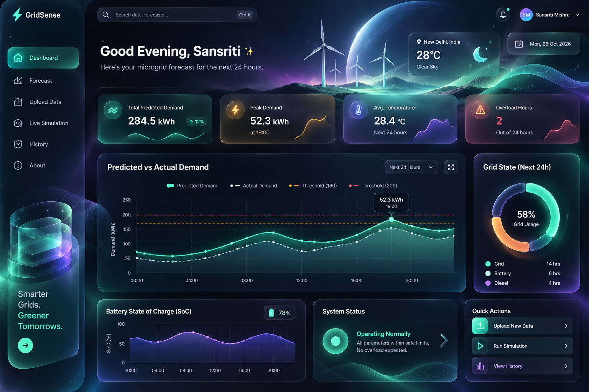

# GridSense — Smart Energy Microgrid Forecasting & Control

GridSense is a smart microgrid intelligence platform that combines weather-aware demand forecasting, battery dispatch control, and a production-ready dashboard for operational decision-making. The application ingests hourly telemetry, cleans the input payload, constructs a fixed predictive feature vector, calls a QuickML regression endpoint, and translates the predicted demand into actionable power-source decisions.

The system is designed to be more than a forecast demo: it turns a prediction into a microgrid policy decision by deciding whether the system should prioritize renewable storage, main-grid supply, or overload protection based on the forecasted load and time-of-day conditions.

## Live deployment

- Public app: https://gridsense-50047192240.development.catalystappsail.in/
- Health endpoint: https://gridsense-50047192240.development.catalystappsail.in/api/health

## Project tagline

A smarter grid begins with a better forecast — and a better forecast becomes a safer, greener, more resilient microgrid.

## Why this project matters

Modern energy systems require rapid, data-driven control decisions because weather variability, peak-hour demand, and renewable intermittency can create instability. GridSense addresses that by combining:

- accurate demand forecasting,
- logic-driven switching between grid and storage,
- battery state-of-charge simulation,
- clear human-readable dashboard insight, and
- a deployment-ready web application on Catalyst.

This is especially relevant for intelligent microgrids, community energy systems, and renewable-heavy energy environments where forecast-driven control can reduce peak strain, maintain stability, and improve utilization of local energy assets.

## App overview




## Problem solved

The challenge is to convert raw weather and demand data into a forecast and then act on that forecast in a decision-making system. GridSense solves this by creating a complete energy intelligence loop:

1. Load telemetry and weather inputs
2. Validate and clean the dataset
3. Build the exact feature vector required by the model
4. Run prediction through QuickML
5. Apply controller logic to choose the active mode
6. Simulate battery and solar dispatch
7. Display results and operational logs in a dashboard

## What the system does

- Accepts hourly telemetry or uploaded CSV files
- Validates timestamps and numeric data quality
- Engineers the exact fixed feature set used in the forecast pipeline
- Calls the published QuickML model endpoint for hourly demand prediction
- Interprets forecasted demand into operational states
- Applies grid/storage dispatch rules and overload handling
- Simulates battery state of charge and renewable contribution
- Stores run history, logs, and decision evidence for review

## Key feature contract

The model uses a fixed feature contract for consistent training and inference.

### Input features

- ambient_temp_c
- humidity_pct
- solar_irradiance_wm2
- hour
- dow
- is_weekend
- hour_sin
- hour_cos
- is_peak_window
- cdd
- hdd
- temp_x_hum

### Target variable

- target_demand_kw

### Important rules

- `target_demand_kw` is the supervised target, not an input feature.
- The feature order is fixed and must be kept consistent across training and inference.
- For gradient-boosted tree models like LightGBM, normalization is not required.
- The prediction response is read from the first value in the `result` array.

## QuickML contract

Example valid request payload:

```json
{
  "data": {
    "ambient_temp_c": 26.84,
    "humidity_pct": 57.79,
    "solar_irradiance_wm2": 466,
    "hour": 10,
    "dow": 1,
    "is_weekend": 0,
    "hour_sin": 0.5,
    "hour_cos": -0.8660254038,
    "is_peak_window": 0,
    "cdd": 4.84,
    "hdd": 0,
    "temp_x_hum": 15.510836
  }
}
```

Example valid model response:

```json
{
  "result": [167.180451578077]
}
```

This indicates a predicted demand of approximately 167.18 kW for that forecast row.

## Model quality and benchmarking

The forecasting pipeline was evaluated using time-aware validation instead of random splitting, so the benchmark reflects realistic chronological performance.

### Verified local forecasting metrics

- MAE: 7.1238
- MSE: 81.3541
- RMSE: 9.0197
- RMSLE: 0.0663
- R²: 0.9671
- MAPE: 5.0864

These metrics indicate a strong forecasting model with high explanatory power and low error. MAPE can be noisy when demand values are near zero, so it should be interpreted alongside RMSE, MAE, and R² rather than in isolation.

## Controller logic

The control engine converts the predicted demand into a dispatch policy.

| Condition | Decision |
|---|---|
| Predicted demand > 160 kW | Renewable storage mode |
| Timestamp hour is 18:00 to 22:00 inclusive | Renewable storage mode |
| Predicted demand >= 200 kW | Critical overload state |
| Otherwise | Main-grid mode |

This logic is implemented in a transparent, testable decision layer so the dashboard and the underlying dispatch rule remain aligned.

## Architecture

### End-to-end flow

```text
User / Browser / CSV Upload
           │
           ▼
Flask App (AppSail)
           │
           ├── Input validation
           ├── Feature engineering
           ├── QuickML prediction request
           ├── Controller decision engine
           ├── Battery + solar simulation
           └── Logs / history / dashboard response
```

### System components

- Frontend UI: Flask static dashboard with Chart.js
- API backend: Python + Flask
- Forecast engine: QuickML regression inference
- Controller logic: rule-based microgrid dispatch engine
- Persistence: safe logging and run history storage
- Runtime: Zoho Catalyst AppSail

## Repository structure

- `app/app.py` — main Flask backend and route orchestration
- `app/quickml_client.py` — QuickML request and response handling
- `app/controller.py` — controller dispatch logic
- `app/battery.py` — solar, battery, and grid dispatch simulation
- `app/ingest.py` — data parsing and feature engineering
- `app/persist.py` — runs, logs, and history management
- `app/static/` — frontend dashboard assets
- `ml_lab/` — experimental model selection and validation
- `data/` — demo and training telemetry datasets
- `tests/` — automated coverage for API, model, and controller behavior
- `reference_design.png` — architecture and concept visual

## Tech stack

- Python 3
- Flask
- Pandas
- NumPy
- scikit-learn
- QuickML / Catalyst integration
- Chart.js for dashboard visuals
- Zoho Catalyst AppSail deployment model

## App features

- Microgrid demand forecasting dashboard
- Hour-by-hour demand forecast display
- Renewable-storage and main-grid mode switching
- Overload detection and alerts
- Battery state-of-charge simulation
- CSV upload and manual forecast input
- Historical run tracking and logs
- Real-time dashboard explanation and operational summary

## Screenshots and visuals

### Dashboard overview


### Energy concept visual


### Additional project visual asset


## Local setup

### 1. Create environment

```bash
python -m venv .venv
```

### 2. Activate environment

Windows:

```bash
.venv\Scripts\activate
```

macOS/Linux:

```bash
source .venv/bin/activate
```

### 3. Install dependencies

```bash
pip install -r requirements.txt
```

### 4. Run the application

```bash
python app/app.py
```

### 5. Access the app

Open the app in a browser at:

```text
http://localhost:9000/
```

## Catalyst deployment configuration

The project is designed to run on Zoho Catalyst AppSail and expects a few runtime environment variables.

### Required configuration

- `QUICKML_ENDPOINT_URL`
- `QUICKML_ENDPOINT_KEY`
- `ZOHO_CLIENT_ID`
- `ZOHO_CLIENT_SECRET`
- `ZOHO_REFRESH_TOKEN`

### Optional configuration

- `QUICKML_ORG_ID`
- `X_ZOHO_CATALYST_ORG_ID`
- `PREDICT_PROXY_KEY`

When the official QuickML endpoint is unavailable, the app gracefully falls back to a deterministic local forecasting path so the dashboard remains usable for demos and local validation.

## Testing and validation

The repository includes automated checks for:

- API behavior
- persistence and fallback handling
- model pipeline correctness
- feature-engineering consistency
- QuickML payload contract
- controller decision logic
- battery simulation logic

### Run tests

```bash
pytest -q
```

### Health validation

```bash
curl http://localhost:9000/api/health
```

## Final submission narrative

GridSense was created to demonstrate that a smart microgrid can go beyond a static visualization and become an actionable energy management system. It combines forecasting, dispatch logic, battery simulation, and a clean interface into a single real-world workflow.

The system does not simply show predicted demand; it interprets that prediction to decide how energy should be used. It prioritizes local renewable assets when the forecast suggests strain or peak-hour risk, protects the microgrid during overload periods, and can explain the decision in plain operational terms.

This makes GridSense a credible, production-inspired solution for next-generation energy monitoring and control, while still remaining simple enough to deploy, demonstrate, and explain clearly in a hackathon context.

## Submission checklist

- [x] Working public Catalyst deployment
- [x] Forecast pipeline and QuickML integration
- [x] Feature contract and model input consistency
- [x] Controller logic with overload detection
- [x] Battery and renewable dispatch simulation
- [x] Dashboard UI and operational explanation
- [x] Logs, history, and run tracking
- [x] README and architecture documentation
- [x] Final validation ready for submission

## Final note

This repository is prepared as a final-project submission artifact for GitHub and review. It includes the application, the forecasting logic, the deployed architecture story, the UI experience, validation logic, and the documentation needed to present the project clearly and credibly.
